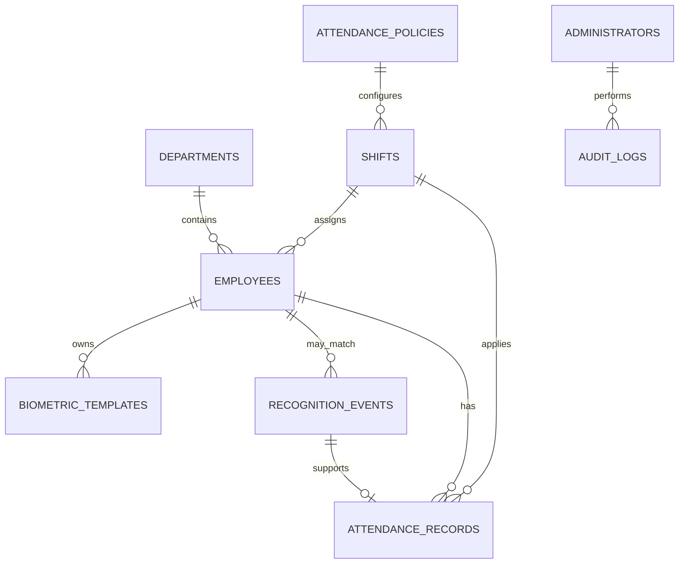

# Database Schema

**Phase:** 2 design. The tables below are proposed; no database has been created or modified.
**Timestamp convention:** Store all event timestamps in UTC. Convert to the organisation's configured IANA timezone only when applying local-date rules or displaying results.

## Relationship overview

## Tables

| Table | Important columns | Design notes |
| --- | --- | --- |
| `administrators` | `id`, unique `email`, `password_hash`, `role`, `is_active`, `last_login_at`, timestamps | Passwords are hashes. Roles begin with `admin` and can later support `manager`/`auditor`. |
| `departments` | `id`, unique `name`, `is_active`, timestamps | Deactivate rather than delete if employees/history reference it. |
| `shifts` | `id`, unique `name`, local `start_time`, `end_time`, `crosses_midnight`, `is_active`, timestamps | Defines schedule; policy holds rules that can change independently. |
| `attendance_policies` | `id`, `name`, optional `shift_id`, effective start/end dates, grace/late/early minutes, cooldown seconds, minimum work minutes, frequency limit, active flag | Policies are versioned by effective date; an attendance record references the policy used. |
| `employees` | UUID `id`, unique `employee_code`, names, optional unique work email, `department_id`, `shift_id`, `is_active`, `biometric_consent_at`, `consent_version`, timestamps | Employee code is the stable public identifier. Consent is required before biometric registration. |
| `biometric_templates` | UUID `id`, `employee_id`, protected template payload/reference, algorithm/model version, quality score, consent version, `created_at`, `revoked_at`, `delete_after_at` | No raw image is required here. Limit access to a dedicated biometric service and privileged administrator operations. |
| `recognition_events` | UUID `id`, nullable `employee_id`, `occurred_at`, camera identifier, recognition decision, score, model version, reason code | Records decision evidence. Unknown events need no employee relation; avoid storing frames by default. |
| `attendance_records` | UUID `id`, `employee_id`, `attendance_date` in organisation timezone, `shift_id`, `policy_id`, `check_in_at`, `check_out_at`, status, late/early minutes, source-event IDs, timestamps | Unique `(employee_id, attendance_date, shift_id)` prevents duplicate daily records. |
| `attendance_corrections` | UUID `id`, `attendance_record_id`, `requested_by/approved_by`, old/new values, reason, timestamps | Manual changes are additive and auditable, not silent edits. |
| `audit_logs` | UUID `id`, nullable `administrator_id`, action, target type/id, occurred time, minimal JSON metadata | Tracks sensitive administration and privacy actions without storing passwords/templates. |
| `app_settings` | singleton/typed `key`, `value`, updated timestamps | Holds organisation name, timezone, and system defaults; secrets remain environment variables. |

## Key constraints and indexes

- Unique `administrators.email`, `departments.name`, `shifts.name`, and `employees.employee_code`.
- Foreign keys use restrictive or soft-delete-friendly rules so historical attendance cannot become orphaned.
- `attendance_records` has a unique constraint on `(employee_id, attendance_date, shift_id)`.
- Index employee search on `employee_code`, case-insensitive name fields, and active status.
- Index `recognition_events` and `attendance_records` by `(employee_id, occurred_at/attendance_date)` and by date for reports.
- Validate that grace/cooldown/minimum-work values are non-negative and applicable policy dates do not overlap unintentionally for the same scope.
- Use database transactions for attendance decisions. The service checks policy; the database enforces identity and duplicate invariants.

## Flexible attendance policy model

The attendance engine should receive a policy object rather than hard-coded times. A policy can define check-in/open/close windows, grace minutes, late threshold, early-departure threshold, required working duration, cooldown duration, and allowed event frequency. Assign policies to a shift (or organisation default) with effective dates. This allows the administrator to change a rule by publishing a policy version, rather than changing Python code.

## Check-in, check-out, and correction semantics

1. A successful recognition produces a `recognition_event`; it is not automatically proof of an attendance action until policy validation succeeds.
2. If no record exists for the employee/day/shift, an allowed event creates a record and sets `check_in_at`.
3. If a record has check-in but no checkout, a later allowed event sets `check_out_at`.
4. Events in the cooldown window, events outside allowed windows, and ambiguous/multiple-face events are recorded as rejection reasons where retention policy permits; they do not alter attendance.
5. Administrators correct attendance through `attendance_corrections`, recording who changed what and why.

## PostgreSQL compatibility

Avoid SQLite-only SQL and keep IDs/constraints in SQLAlchemy migrations. SQLite is adequate for an individual demonstration. PostgreSQL should be used for concurrent deployment, stronger operational controls, and reliable multi-user writes. A migration test against both engines will be part of implementation verification.

## Biometric deletion procedure (design)

An authorised administrator verifies an employee deletion/revocation request, revokes active template records immediately, deletes protected template data according to the configured retention window, and writes an audit log. Attendance records are retained or anonymised only according to the organisation's stated legal/academic policy. The interface must explain this distinction before deletion is confirmed.
