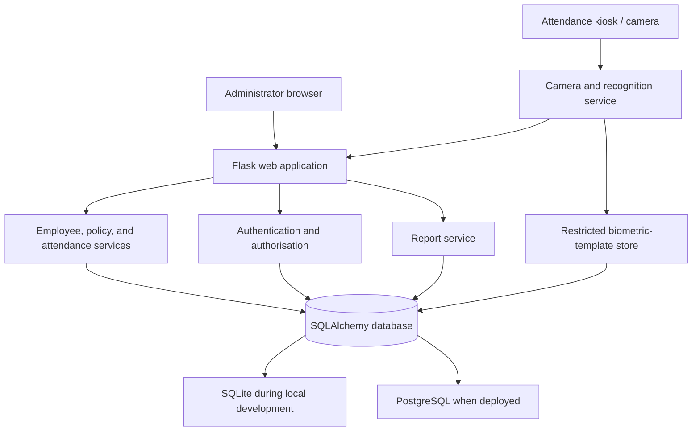
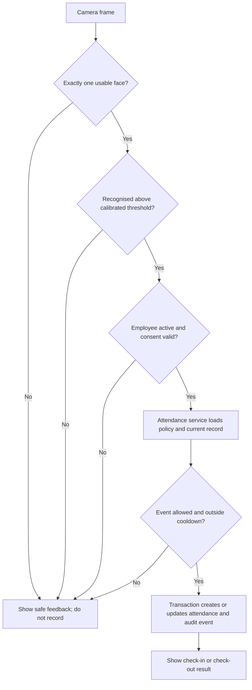

# Project Architecture

**Phase:** 1 foundation implemented; recognition and production features remain planned.
**Last updated:** 3 November 2026

## 1. Purpose

The final system will be a web application for authorised administrators to manage employees and attendance, along with a controlled kiosk-style recognition interface for recording attendance events.

Python and OpenCV will remain central to the project. Flask will organise the web application, while OpenCV will handle camera access and image preparation.

This document describes the target architecture. The Phase 1 Flask/SQLite employee foundation is implemented; modules not identified as implemented below remain planned.

## 2. Chosen Architecture



The application will use a layered architecture:

- **Routes and templates:** Handle user requests and the web interface.
- **Services:** Contain business rules and application logic.
- **SQLAlchemy models:** Manage database entities and data access.
- **Recognition service:** Provides an isolated interface for face detection and recognition.

This separation allows recognition models to be evaluated or replaced without rewriting employee management or attendance rules.

## 3. Proposed Folder Structure

```text
FaceAttendance/
|
+-- app/
|   +-- __init__.py                 # Flask application factory
|   +-- config.py                   # Validated environment settings
|   +-- extensions.py               # Database, migrations, login/session setup
|   +-- models/                     # SQLAlchemy models
|   +-- services/                   # Attendance rules, reports, biometric lifecycle
|   +-- recognition/                # Detector and recognizer interfaces
|   |   +-- lbph_legacy.py           # Adapter for the preserved LBPH prototype
|   |   +-- embedding.py             # Candidate embedding adapter after evaluation
|   |   +-- quality.py               # Face and sample quality checks
|   +-- routes/                     # Admin, employee, attendance, auth, report routes
|   +-- templates/                  # Jinja HTML templates
|   +-- static/                     # CSS, JavaScript, non-sensitive assets
|
+-- migrations/                     # Database migrations
+-- tests/                          # Unit and integration tests
+-- scripts/                        # Administrative and maintenance commands
+-- instance/                       # Local database and runtime files
+-- legacy/                          # Preserved original LBPH scripts
+-- docs/                            # Supplementary diagrams and documentation
|
+-- requirements.txt
+-- .env.example
+-- README.md
+-- Other documentation files
```

Existing prototype scripts, model files, and the dataset will remain unchanged during Phase 2.

If the original scripts are later moved into `legacy/`, the move will be documented and performed only after approval. Their current paths are not being changed.

## 4. Main Modules and Responsibilities

| Module | Responsibility |
|---|---|
| Authentication | Allows authorised administrators to sign in securely. Passwords are stored as hashes, never as plaintext. |
| Employee management | Creates employee codes, manages department and shift assignments, and deactivates records without deleting attendance history. |
| Biometric registration | Collects consent, guides camera capture, checks sample quality, and stores approved templates and metadata according to the retention policy. |
| Recognition | Detects faces, applies quality and multiple-face checks, requests a match from the selected recognizer, and returns a decision with confidence evidence. It does not independently mark attendance. |
| Attendance engine | Applies attendance policies, including check-in/check-out states, shifts, grace periods, late/early calculations, cooldowns, and duplicate prevention. |
| Dashboard and reports | Displays permitted attendance data, summaries, filters, and CSV/XLSX/PDF exports. |
| Audit and privacy controls | Records sensitive administrative actions, restricts biometric access, and supports retention and deletion requests. |

## 5. Attendance Decision Flow



The attendance service will validate every event before recording it.

Database-level uniqueness constraints will provide the final protection against duplicate attendance records. The application will not rely solely on user-interface checks.

## 6. Technology Decisions

| Technology | Decision and reason |
|---|---|
| Python | Chosen because it already powers the prototype and provides computer-vision and database tooling. |
| Flask | Chosen for a compact, understandable, server-rendered application. A separate JavaScript frontend and API would add unnecessary complexity at this stage. |
| SQLAlchemy and migrations | Provide structured database access and allow SQLite during local development while keeping the schema portable to PostgreSQL. |
| SQLite to PostgreSQL | SQLite is suitable for a single-machine demonstration. PostgreSQL is the intended option for multi-user or network deployment. |
| OpenCV | Remains responsible for camera access, face detection, and image preparation. |
| Jinja, CSS, and JavaScript | Provide a responsive interface without requiring a separate frontend build system. |
| pandas, openpyxl, and ReportLab | Deferred until reporting is implemented because they serve specific export requirements. |

## 7. Security and Privacy Design

The application will follow these security principles:

1. **Password security:** Use Werkzeug password hashing. A strong `SECRET_KEY` must be supplied through environment variables in deployed environments.
2. **Request protection:** Protect state-changing web actions with CSRF protection and validate inputs on the server.
3. **Authorisation:** Enforce role checks in routes and services, not merely by hiding interface elements.
4. **Biometric separation:** Store biometric templates separately from ordinary employee details. Never expose template contents through the interface or reports.
5. **Data minimisation:** Do not collect or retain raw face images by default. Temporary captures should be deleted after template creation unless a separately documented consent and retention policy permits retention.
6. **Consent:** Require recorded consent before biometric registration.
7. **Deletion and revocation:** Support biometric-template revocation and deletion while retaining only the minimum necessary audit evidence.
8. **Storage security:** Use restricted filesystem permissions, backups, and encrypted-at-rest storage where deployment risks warrant it.
9. **Liveness limitations:** Basic blink or head-motion checks are only weak user-presence signals. Strong presentation-attack detection requires a validated liveness/PAD solution and suitable testing. It will not be claimed without evidence.

## 8. Deployment Design

### Local development

The proposed local setup will use:

- Flask application server.
- SQLite database.
- An `.env` file excluded from Git.
- A directly attached webcam for kiosk recognition.

### Production deployment

The proposed production setup will use:

- A production WSGI server.
- HTTPS.
- PostgreSQL.
- Restricted database credentials.
- Managed backups.
- Environment-based secrets.
- An authenticated administrator network.

Camera recognition should run on the kiosk machine or a trusted local service. Raw camera streams should not be exposed publicly.

## 9. Dependency and Environment Plan

Package versions will be verified for compatibility with the supported Python version during implementation.

The planned application dependencies include:

- Flask
- SQLAlchemy
- Flask-Migrate
- Flask-Login
- Flask-WTF
- python-dotenv
- OpenCV contrib
- NumPy
- pytest

Additional reporting and database-driver packages will be introduced when their respective modules are implemented.

**Current verification:** A project-local Python 3.12 virtual environment has installed and imported the declared dependencies. Flask/SQLite foundation tests are passing. Camera, recognition, model, and hardware tests have not been performed.

## 10. Model and Licensing Boundary

The proposed research adapter will support an ArcFace-style embedding model, such as a suitable InsightFace model pack, while keeping the recognition implementation replaceable.

The licensing distinction is important:

- InsightFace's code is released under the MIT licence.
- Its supplied pretrained public models have non-commercial research restrictions.

Consequently, evaluating a public pretrained model for a portfolio project does not grant permission to use it for commercial or internal employee-attendance deployment.

A separately licensed model or explicit authorisation must be obtained before any such deployment.

## 11. Current Implementation Status

The following distinction must be maintained throughout development:

| Component | Current status |
|---|---|
| Original OpenCV/LBPH prototype | Exists as legacy code |
| Existing face dataset | Exists but has documented quality limitations |
| Flask application factory, dashboard, and templates | Implemented and tested locally |
| SQLAlchemy SQLite employee/attendance foundation | Implemented and tested locally |
| Administrator authentication | Planned, not implemented |
| Employee management (code, name, department, active status) | Implemented and tested locally; no authentication yet |
| Biometric registration workflow | Planned, not implemented |
| New embedding-based recognition | Research/planning stage |
| Attendance dashboard | Basic count summary implemented; reporting is planned |
| Automated application test suite | Phase 1 tests implemented (12 passing); broader coverage planned |
| Production deployment | Not started |

This architecture is an approved design for future development, not evidence of a completed or production-ready attendance system.
